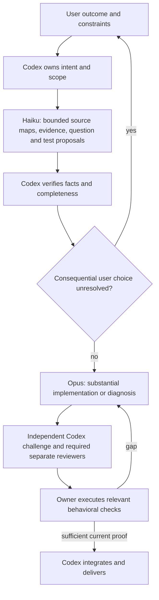

# Claude-first routing: measured behavior and release scope

The new routing preference permits Opus to own most substantial implementation and Haiku to own bounded support, with Codex coordinating intent, integration and independent verification. **The evaluated prompt bundle did not improve verified task success.** Routing follows the user's preference and task suitability; this study does not prove Claude superiority or a cheaper route.

## Registered main comparison

Six public historical Tweed PR tasks (31, 32, 34, 35, 39 and 40), two repeats and four arms produced all 48 assigned attempts. The baseline arm used Confidence Protocol 0.6 guidance and Opus; the enhanced arms used the same frozen candidate-1 guidance with Opus, Haiku or requested Codex Astra. The [preregistration](PREREGISTRATION.md) preceded inference. This tests the complete instruction bundle, not an isolated question phrase.

Requirements, task inputs, operational MCP tools and owner oracles were shared. Effort labels were medium, with 240 seconds per main attempt and a two-dollar Claude CLI guard. Native harness internals differ and the same effort label does not imply equal compute. Codex had no equivalent dollar guard. The initially requested Sol route failed qualification on this account before registration; its failed attempt was retained and qualified Astra was chosen before the cohort. Claude assistant events observed the exact requested Opus and Haiku identifiers. Codex's runtime model was unobserved; its twelve attempts are attributed to the requested route only. No started cell was retried or substituted.

| Arm | Assigned | Eligible | Recorded verified successes | Unknown software semantics | Registered-oracle false-completion events / completion declarations |
| --- | ---: | ---: | ---: | ---: | ---: |
| Baseline Opus | 12 | 11 | 8 | 1 | 3 / 11 |
| Enhanced Opus | 12 | 11 | 6 | 1 | 5 / 11 |
| Enhanced Haiku | 12 | 8 | 1 | 4 | 6 / 6 |
| Enhanced requested Astra | 12 | 5 | 5 | 7 | 0 / 5 |

Verified success means a qualified recorded owner-oracle pass. Unknown or unqualified attempts count as zero verified evidence in the registered assigned denominator; they are not established semantic failures. These success and false-completion metrics concern the selected registered oracle, not every requested behavior: the subsequent review and routing probe found additional defects, including in originally accepted artifacts. Those diagnostics do not rewrite the primary table. A worker's `complete: true` alone is not a full Confidence Protocol completion certificate. Worker-declared empty remaining gaps occurred in zero baseline Opus, zero enhanced Opus, zero Haiku and two Codex cases.

| Registered contrast | Assigned success difference | Exploratory 95% task-cluster interval | Task wins / losses / ties |
| --- | ---: | ---: | ---: |
| Enhanced Opus − baseline Opus | −16.7 percentage points | [−33.3, 0.0] | 0 / 2 / 4 |
| Enhanced Haiku − enhanced Opus | −41.7 percentage points | [−83.3, 0.0] | 1 / 4 / 1 |
| Enhanced requested Astra − enhanced Opus | −8.3 percentage points | [−50.0, 25.0] | 1 / 1 / 4 |

Intervals enumerate all 46,656 whole-task bootstrap resamples across six task clusters. These are exploratory summaries of a small, purposively chosen, familiar sample in one repository. They are not population estimates, significance tests or model rankings. Logical bounds allowing unknown software outcomes differ from these intervals; both appear in the [machine-readable results](results/analysis.json). Opus prompt-bundle losses were on PR32 and PR40; there were no task-level gains over its baseline. Haiku succeeded on one PR39 repeat. There was no Luna, Terra or Sonnet comparison.

## Evidence custody and analysis qualification

The analysis checks the full assignment roster, raw versus normalized receipts, actual request envelopes, runtime observations, tool dispatches, terminal responses, production snapshots and reconstructed patches. All 48 patches, including empty or partial outputs, are preserved byte for byte in [the patch directory](results/patches). Public export uses a field allowlist and hashes; private transcripts and account data are not published.

The historical main grader did not record an input digest. It is therefore incorrect to claim continuous historical source binding. Separately, fresh CPU-only checks bound current source, the actual oracle dependency tree and sibling grader fixtures before and after execution, and required equivalence to the registered task base. All **35 eligible current-source rechecks agreed with their original recorded grades**. They did not replace the primary results. [Artifact hashes](results/artifact-hashes.json) distinguish these records.

Independent synthetic analysis audits exercised 86 controls before final closed-result analysis. Two earlier real analysis attempts stopped before producing results or invoking a grader: a bounded server rejected a disallowed command proposal, and a provider parser rejected malformed tool input. Qualified handling now recognizes only exact bound pre-execution rejection evidence, separately from dispatched tools. Native forbidden execution, mismatched arguments, successful forbidden calls and spoofed rejection evidence remain rejected. The owner had observed execution progress and outcomes; this analysis qualification is not represented as a blind owner evaluation.

Known CLI cost-estimate subtotals were $7.639722 for baseline Opus, $7.5439196 for enhanced Opus and $7.1479302 for Haiku. Timeout telemetry is missing and Codex dollar estimates are unavailable. These are incomplete CLI estimates, not bills or proof of savings, quota pooling or Haiku's relative price advantage. End-to-end verification and repair effort also matters.

## Intake and subsequent maintenance evidence

The separate [intake report](INTAKE-REPORT.md) covers all twelve scripted episodes and a fresh anonymous semantic review. The improved guidance used fewer questions in this sample, but both policies produced one unsupported readiness claim. Source facts were supplied, and no answer-dependent feature was implemented in that study. It does not establish automatic discovery, lower user burden, lower cost or flawless clarification.

The [prospective eight-case maintenance probe](FOLLOWUP-REPORT.md) extends PR40 with a new `unbounded` budget value while preserving the original selected behavior. All eight available initial sources remain included, without filtering by original acceptance. Seven follow-ups pass both checks with qualified delivery; one times out. Four original sources were accepted and four had unknown acceptance; there is no initially broken cohort. The [custody amendment](FOLLOWUP-CUSTODY-AMENDMENT.md) explains a pre-call preparation failure and its narrow unused-scratch exclusion. Maintenance outcomes and [anonymous code reviews](QUALITY-REPORT.md) are reported separately; they are not pooled into the main success comparison.

The [later revisions](LATER-REVISIONS.md) identify guidance fixes outside the frozen treatment, including the necessary-versus-sufficient completion question. No efficacy claim for those fixes follows from candidate 1's results. The initial owner contract's universal intake claim was contradicted and retained as unmet; the successor reporting obligation measures these errors rather than rewriting them into successes.

## Installed behavior

The release adds a conditional question-pattern reference and Claude-first task routing, not an installed dispatcher or extra dependency. Haiku can extract evidence, map bounded sources and propose questions or tests; the owner checks completeness. Only owner-classified low-risk isolated edits use Haiku after route qualification. Opus is preferred for difficult implementation, coupled changes and maintainability review. Codex retains user decisions, integration, independent challenges, executed proof and delivery. Required Critical review roles remain separate and cannot be replaced by smaller-model assistance or worker agreement.

The guide adapts Matt Pocock's clarification, source discovery, counterexample, hypothesis and simplicity fundamentals with attribution. It does not install all 27 skills or impose a fixed questionnaire. Existing source answers questions first; unresolved consequential choices go to the user. The runtime proof machinery is unchanged apart from its version identifier.

Haiku can perform owner-classified isolated low-risk edits after qualification. Quick tasks stay direct; the diagram describes a substantial task and is not a mandatory ladder.
