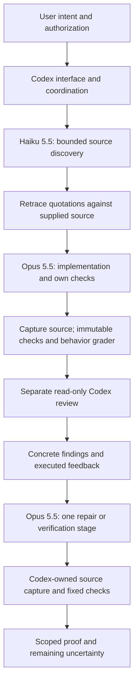

# Lean repair 0.8.1: small paired full-loop pilot

**No improvement over the original is established. Keep 0.8.1 experimental and
source-only; the installed 0.8.0 is unchanged.** Actual Opus authored this lean
revision, Haiku supplied checked source quotations, and separate Codex actors
designed the proof and checked the implementation, controller and results.

Three previously unreplayed historical PR identities supplied six development
attempts. Every attempt reached a separate Codex review and an Opus closure stage.
All six recorded first/final selected behavior grades pass, but only four whole
cells survive current-byte custody reconstruction. Both PR37 cells remain
unqualified because installation-test scratch contains symlinks rejected by the
frozen analyzer. Their current source, patches, grade output and immutable checks
are independently bound as **partial product evidence**, not promoted to whole-cell
success. All six recorded closures retain caveats, and no production patch changed
during closure. This pilot does not demonstrate production bug repair.

## What changed

The [prospective design](DESIGN.md), [actual lead receipts](LEAD-PROOF.json) and
[independent guidance review](GUIDANCE-REVIEW.json) bind the changes:

- Stop intake when no required consequential decision or necessary fact blocks
  the next authorized action. Investigate facts first; defer optional choices
  visibly when behavior and scope are preserved. Necessary unknowns remain gaps.
- Return concrete findings to Opus, which owns repair and affected checks. Codex
  rechecks and integrates; a Codex fallback repair records Codex as its author.
- Pair requirements with evidence and a relevant negative/boundary check. A known
  counterexample remains a gap despite a passing suite, reference or agreement.
- Keep an actor's own repair checks distinct from independent review.

The four main guides grow from **361 to 382 lines**, a size proxy, with no new
dispatcher, workflow section, schema, runtime dependency or installed hook. The
core evidence engine is unchanged; diagnostics changes only its version string.
The source manifest is 0.8.1. Research controllers and artifacts are excluded from
the installed plugin release.

Existing Matt Pocock adaptations stay in place: fact discovery before questions,
neutral consequential choices, specification/acceptance before implementation,
and review/PR/retro flows. The previous [Opus research](../opus-led-redesign.md)
records their pinned sources and adoption limits. No additional Matt skill was
installed or automatically invoked in this pilot. These fully specified tasks
do not measure improved user questioning or intake quality. The research-only
[answer-delivery correction](answer_delivery.py) handles two previously missed
numeric-precedence wordings with four adjacent negatives; it was unused here and
is not semantic grading or evidence of better intake.

## Actual route and controlled comparison

This is the **executed experiment route**. Both original and revised guidance get
that route, the same checked Haiku quotations, shared current runtime, budgets and
packet boundaries. Only their full guidance trees differ: the previously sealed
original 0.6 instructions versus candidate 0.8.1. This is not an ablation of model
selection or independent evidence that Haiku/cross-provider routing helps. Normal
guidance keeps Quick work direct and Haiku optional when retracing is cheaper than
doing the discovery directly; it adds no automatic model dispatcher.

Opus and Haiku identities are observed in actual assistant events. Reviews request
`gpt-6-astra` at medium effort; their streams do not establish the actual model, so
attribution is **requested-only**. Native proof-design/adversarial actors' actual
model metadata is unobserved. No model ranking or subscription-usage saving follows.

## Registration and task scope

[Discovery registration](DISCOVERY-REGISTRATION.json) was committed at
[`ee63698`](https://github.com/e3-solutions/tweed/commit/ee63698), before the three
actual task-discovery calls. [The six-cell registration](REGISTRATION.json) and
[preregistration](PREREGISTRATION.md) were committed at
[`43cd390`](https://github.com/e3-solutions/tweed/commit/43cd390), before development
inference. The private registration SHA256 is
`e2fddcd40281f75c1863bc2a2301d02eb36946cb1ff4fdf392f503394be74948`.
Activation and independent preflight precede the first call. No started attempt
was retried and no result patch, original score or registered input was repaired.

| Task | Public historical behavioral slice | Consequential checks |
| --- | --- | --- |
| [PR20](https://github.com/e3-solutions/tweed/pull/20) | Model selection, CLI/environment precedence and child propagation | Defaults omitted, opaque TOML values, trimming/blank rejection, explicit override of blank environment, same-session resume |
| [PR23](https://github.com/e3-solutions/tweed/pull/23) | Reasoning selection and propagation alongside model selection | Medium default, all three children, trimming/blank rejection, coexistence and resume |
| [PR37](https://github.com/e3-solutions/tweed/pull/37) | Queued activity after budget-steer acknowledgement | Valid continuation/clarification, invalid wrap-up rejection, unchanged steering rejection/resume and process cleanup |

These are fresh **task identities for this evaluation**, not recent new PRs,
full-PR acceptance or unknown mechanisms. PR31/32/34/35/39/40 were previously used
and excluded; related PR43/44 were avoided. [Task controls](TASK-CONTROLS.md) include
three base failures, three accepted-head passes, three representation-equivalence
passes and six focused baseline passes. A passing historical reference is a
comparison subject, not the definition of correctness. Original tests and owner
checks are immutable in grading; actor-added tests cannot weaken acceptance.

Order: PR20 revised/original, PR23 original/revised, PR37 original/revised. Each
Opus main stage has 480 seconds/USD4, review 180 seconds, and the sole Opus closure
300 seconds/USD3, under an aggregate 1100-second ceiling. Actual CLI versions are
Claude Code 2.1.285 and Codex CLI 0.154.0. Dollar guards and CLI list-price estimates
are not invoices. The final fixed grader was disclosed as feedback, so it is not
an unseen post-repair holdout. The preflight's CPU forced-failure controls simulate
an actor edit; they are not observed model repairs.

## Primary results — unchanged criteria

[Machine-readable results](RESULTS.json) retain exact primary derivation, rejection
reasons, stage hashes, source/diff custody and supplemental errors.

| Task/arm | Selected first/final behavior | Whole-cell custody | Registered first pass | Strict final delivery | Production repair |
| --- | --- | --- | --- | --- | --- |
| PR20 original | PASS / PASS | PASS | PASS | Rejected: nonempty remaining | None |
| PR20 revised | PASS / PASS | PASS | FAIL: README scope | Rejected: scope and nonempty remaining | None |
| PR23 original | PASS / PASS | PASS | PASS | Rejected: nonempty remaining | None |
| PR23 revised | PASS / PASS | PASS | PASS | Rejected: nonempty remaining | None |
| PR37 original | PASS / PASS, partial evidence only | ERROR: scratch symlinks | Unqualified | Not certified | No changed production patch; partial evidence |
| PR37 revised | PASS / PASS, partial evidence only | ERROR: scratch symlinks | Unqualified | Not certified | No changed production patch; partial evidence |

The frozen analyzer counts **2/3 original versus 1/3 revised first passes, with
one unqualified cell each; 0/3 strict final acceptances each**. These are delivery
and provenance criteria, not six code-accuracy failures. Four qualified cells pass
their selected behavior checks; both unqualified cells have separately bound
passing behavior artifacts. No broader correctness, quality or superiority claim
is supported by three historical slices with one attempt per arm.

All six independent reviews reported no findings. That does not establish absence
of defects; review scope and model attribution limits are retained. Opus closure
was actual inference in every cell, but a no-change verification stage is not
evidence of production repair. Twelve exact first/final production diffs and
twelve separate scope diffs, including empty ones, are published under
[patches](patches). The failed README edit remains visible.

## What prevented useful repair evidence

1. **Scope failure omitted from the handoff.** The controller records PR20 revised's
   README scope breach, but the review receives only a production diff and the
   repair packet contains behavior/check feedback without the scope verdict or
   nonproduction diff. The original task scope is present, but there is no explicit
   recorded failure to act on. The closure retains the breach. Attribute this to
   handoff coverage as well as the observed instruction-following failure; do not
   claim Opus ignored feedback it did not receive. "Allowed production path" can
   also be read as permitting documentation; this strict slice guard is narrower
   than full historical PR scope.
2. **Remaining work and limitations share a field.** Strict acceptance requires
   `complete=true` and `remaining=[]`. Actual remaining entries include excluded
   live-provider checks, sandbox restrictions on an extra baseline test, explicit
   assumptions and missing complete protocol evidence. Some require further
   investigation for broader acceptance; they do not negate the selected offline
   checks. Keep the original strict rejections and expose scoped product evidence
   separately. Do not reward actors for hiding caveats or retrospectively clear
   their fields. The primary rule also requires no first-stage scope breach, so a
   later scope correction would not recover its registered acceptance.
3. **Ephemeral scratch broke stage custody.** Both PR37 main receipts inventory
   installation-test symlinks. Their targets remain inspectable, but the frozen
   nonsymlink artifact rule rejects them. Preserve those raw receipts, disclose
   the analyzer error, and bind only independently reconstructable partial facts.
   Do not delete symlinks or relax the primary analyzer after outcomes.

These are controller/measurement limits. Adding more protocol prose cannot repair
a packet that omits a failed gate. Future execution should forward every required
gate failure and distinguish required unfinished work from excluded scope limits
before starting. A production repair claim still needs an authentic failing
production candidate followed by actual correction and independent recheck.

## Separate scope-correction appendix

The separately [registered scope-only plan](repair-only/PLAN.md) used the authentic
PR20 revised final candidate, including its failed README edit, for both arms.
Both received the explicit failed scope verdict, nonproduction diff and original
README bytes. This additional feedback is outcome-conditioned; it prevents any
causal policy-superiority claim.

The first pair's two attempts failed before any model request because the copied
candidate already contained `.protocol` and the legacy mount refused that existing
destination. Its [results](repair-only/RESULTS.json), original false readiness
verdict and [independent material correction](repair-only/INDEPENDENT-CORRECTION.md)
are retained. These are infrastructure failures, not model repair failures.

The [explicit amendment](repair-only-v2/AMENDMENT.md) permits one transparent setup
retry in a separately sealed study, with distinct IDs. Actual Opus made the
minimal context-mount correction. The amended [registration](repair-only-v2/REGISTRATION.json)
was committed at [`395669f`](https://github.com/e3-solutions/tweed/commit/395669f)
before inference. [Executed independent dry-run metadata](repair-only-v2/INDEPENDENT-DRYRUN.json)
precedes actual run-start: authentic copying, assigned mounting, Git initialization,
before capture, local MCP transport and full provider request construction were
exercised; the provider process was intercepted before launch. The consolidated
preflight note was saved after root launch, and that timing stays explicit. These
are preflight controls, not simulated model successes.

There are **four assigned supplemental infrastructure-attempt records**: two
pre-inference failures and the two corrected attempts below; only the latter
make model calls. Neither old failed attempt nor any six-cell score is replaced.
No further pair was run.

| Corrected scope call | Actual repair actor | Source change | Production bytes/patch | Independent fixed checks/grade |
| --- | --- | --- | --- | --- |
| Original guidance | Observed Opus 5.5, 51.95s | README restored exactly | Preserved | PASS |
| Revised guidance | Observed Opus 5.5, 82.99s | README restored exactly | Preserved | PASS |

[Corrected results and four exact patches](repair-only-v2/RESULTS.json) bind the
sole 90-second/USD1 calls and 60-second owner-check allowances. Both remove the
authentic scope breach while preserving passing production. Both still disclose
nonempty `remaining`; those declarations stay separate from the fixed scope
outcome. This establishes **correction of this explicit documentation scope
failure**, not production debugging, general repair reliability, or improvement
from revised guidance. Both received the same known-failure packet and restoration
bytes. No scope success adds to the six primary accepted-delivery counts.

## Proof, reproducibility and limits

The [independent final cohort audit](INDEPENDENT-AUDIT.md) and
[metadata](INDEPENDENT-AUDIT.json) reconstruct all six cells, preserve both whole-cell
errors, and qualify only the separately bound partial PR37 facts. A separate
[post-correction audit](repair-only-v2/INDEPENDENT-AUDIT.json) checks the actual
scope-repair calls and publication artifacts. These native Codex checks are
independent of Opus authorship; their exact model metadata is unobserved.

[Current installation bytes](INSTALLATION-CURRENT.json) match the historical
0.8.0 manifest for all 21 files in both source installation and enabled cache.
No installation mutation occurred. [Artifact inventory](ARTIFACTS.json) pins the
published evidence files; raw private receipts remain independently referenced
by their digests. CI on the registered evidence at 78fdcab passed all four jobs:
https://github.com/e3-solutions/tweed/actions/runs/38475009565 . The final proof
commit is checked by the same normal Python 3.10/3.12/3.14 and evaluation-tools CI;
its latest status is attached to PR47. CI does not measure model efficacy.

The [published owner oracles](oracles) are the exact originally sealed code, now
released after the cohort closed. To inspect a behavioral result on macOS, export
the pinned task base with `git archive` to a disposable `pr-N/base` directory,
copy its corresponding published `pr-N/oracle` beside it, copy the base to another
disposable candidate, and apply the selected exact production patch there. Run
`python3 -B pr-N/oracle/evaluate.py --workspace candidate`. The grader uses
`sandbox-exec`, immutable baseline/owner tests, no network and mocked/offline
providers. Use the source inventories in registration to check the baseline bytes;
base failure/head success are controls, not model result substitutes. Replaying a
patch is a new source-bound check, not reconstruction of a model's private stream.
Raw provider streams, auth/session identifiers, command output and private paths
remain private; public metadata pins their hashes and labels its limitations.

The [post-outcome exporter](post-analysis/export.py) was written after the first
scored outcome; its supplemental fields do not replace sealed primary criteria.
It reconstructs developer launch source, prompts, argv/MCP envelopes, check/grade
bindings and scope edits. It returns an error for both unqualified cells rather
than publishing whole-cell acceptance. Current-source focused checks, guidance
review and package CI are delivery proof, not comparative model efficacy.

No complete Critical Confidence Protocol release certificate is claimed. The
preserved private work area includes embedded Git scratch that prevents a clean
whole-root fingerprint; this pilot certifies neither that root nor every contract
of the protocol. Independent designer and adversary scopes are separate and
recorded. The source candidate is not automatically installed or promoted.

The Forum post **“Compact routed repository guidance preserved correctness while
reducing coding-agent tokens”** confirmed using small progressively loaded guidance
rather than expanding the installed core. Its project-specific outcome is not
evidence that this protocol reduces tokens or improves correctness. Feedback was
recorded; the comparison findings remain governed by this pilot's own evidence.
