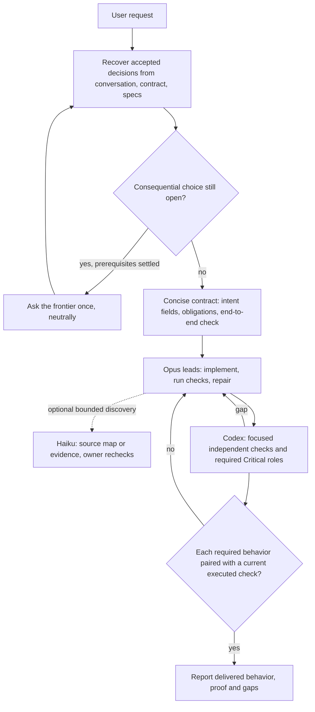

# Opus-led redesign for Confidence Protocol 0.8.0

Date: 2026-10-13. Author role: Opus 5.5 (`claude-opus-5-5`) as design and
implementation lead; Codex integrates and performs the focused review. This is a
**design revision, not a measured improvement**. No new comparative efficacy
trial was run, and no claim is made that 0.8.0 is more accurate than 0.6 or 0.7.1.

## Why change anything

Measured evidence, from retained reports (unchanged by this revision):

- [Main comparison](claude-first-evaluation/REPORT.md): six historical tasks × two
  repeats. Baseline 0.6 guidance with Opus recorded 8/12 verified successes and
  3/11 registered-oracle false completions; the frozen 0.7 candidate-1 bundle with
  Opus recorded 6/12 and 5/11 (task wins/losses/ties 0/2/4). The same bundle with
  Haiku recorded 1/12 and 6/6. The report states these are exploratory, small and
  not rankings.
- [Intake comparison](claude-first-evaluation/INTAKE-REPORT.md): both policies
  produced one unsupported readiness claim, in each case inferring an unanswered
  completion prerequisite from an answer about who owns completion. The candidate
  asked fewer questions (62 vs 84); that does not establish lower user burden.
- [Later revisions](claude-first-evaluation/LATER-REVISIONS.md): the
  necessary-versus-complete question fix was added after the trial and is
  unmeasured.

What this does and does not justify: the sample cannot show that 0.6 is better in
general, but it gives no support for keeping the larger 0.7 bundle as the
default. Design judgment: the default should return to the lean emphasis of the
better-observed baseline, and new text should target only the two observed failure
modes (false completion, inferred readiness) plus the user's requested routing and
reuse of existing components. The 0.8.0 text is not byte-identical to 0.6.

## Sources read

| Source | Pin / date | Used for |
| --- | --- | --- |
| Current skill and references, `skills/confidence-protocol` | HEAD `542f124` | Starting point; CLI, evidence, modes, complex tasks reused unchanged |
| Staged 0.6 baseline guidance, `.confidence/opus-led/context/baseline-*` | Supplied context, untracked | Reference for the restored lean default emphasis |
| Matt Pocock skills: `ask-matt`, `grill-with-docs`, `productivity/grilling`, `to-spec`, `implement`, `diagnosing-bugs`, `code-review` | [`49dd158`](https://github.com/mattpocock/skills/tree/49dd158d1076134a641b33efb035946536778336), MIT, fetched 2026-10-13 | Mechanisms below; prior inventory in [matt-pocock-skills.json](matt-pocock-skills.json) |
| Local GSD entrypoints `gsd-spec-phase`, `gsd-discuss-phase`, `gsd-execute-phase`, `gsd-verify-work` | Supplied context, untracked; upstream not researched | Candidate mechanisms only |
| Claude Code [best practices](https://code.claude.com/docs/en/best-practices), [skills](https://code.claude.com/docs/en/skills), [subagents](https://code.claude.com/docs/en/sub-agents), [permissions](https://code.claude.com/docs/en/permissions) | Fetched 2026-10-13 | Progressive disclosure, plan/skip-plan rule, context isolation, hook and permission limits |
| [Models overview](https://platform.claude.com/docs/en/about-claude/models/overview) | Fetched 2026-10-13 | Confirms `claude-opus-5-5` and `claude-haiku-5-5` are current IDs |
| [anthropics/skills](https://github.com/anthropics/skills) `skill-creator/SKILL.md` | Fetched from `main`; API reported head `dbd4588f9e1033efb41dad4bef2f7947c8993d44` at fetch time | Lean-prompt and explain-why guidance |

Fetch limitation: upstream pages were read through a summarizing fetch tool, not
byte-verified against the inventory hashes. The `anthropics/skills` text was read
from `main`, so its exact match to the reported head is likely but unverified.
No OpenAI sources were consulted; no Codex claims depend on new research.

## Adopted, adapted or rejected

| Component | Decision | Reason |
| --- | --- | --- |
| 0.6 baseline SKILL body | **Adapted** as the lean default emphasis, with the additions below; not a literal restore | Better observed outcome in the only controlled same-model sample |
| Matt `grilling`: ask the frontier of decisions whose prerequisites are settled; agent finds facts itself | **Adapted** (paraphrased) | Matches baseline fact/choice split; makes question order explicit |
| Matt `grilling`: recommended answer for every question | **Rejected** | Risks agreement-by-default; recommendation only when evidence supports one |
| Matt `grill-with-docs` / `domain-modeling`: glossary and ADRs written during interview | **Rejected as default**; reuse existing glossary/ADRs | Adds artifacts most tasks do not need |
| Matt `to-spec` template and tracker publication | **Rejected**; existing contract `intent` fields serve as the spec | Avoids a second spec format and tracker dependency |
| Matt `implement`: test-first at agreed seams, frequent focused checks, full suite at end, review | Already covered by baseline flows | No new text needed |
| Matt `diagnosing-bugs`: symptom-sensitive loop, minimise, falsifiable hypotheses, original-scenario rerun | **Kept** in the optional question-patterns reference | Fixed 3–5 hypothesis count rejected |
| Matt `code-review`: separate standards and spec axes, pinned comparison | **Kept** (already in baseline) | Parallel sub-agent requirement not adopted |
| GSD `discuss-phase`: skip already-decided gray areas; decisions clear enough that downstream agents need not re-ask | **Adapted** as "recover before asking" | Directly targets re-asking and lost decisions |
| GSD phase files, ambiguity scoring, wave execution, mandatory agent dispatch, UAT ceremony | **Rejected** | Universal planning and fixed parallelism; the existing contract, `next --json` frontier and complex-task records already provide state and ordering |
| Existing components: repository workflows, installed Matt or GSD skills | **Adapted** in intent flows: use one when already named and relevant, read its entrypoint first, keep contract intent/proof/authority binding, else follow the built-in sequence | User asked to reuse existing components; no installer, skill scan, nested orchestration or required dependency |
| Anthropic: give the agent a check it can run; show evidence instead of asserting success | **Adopted** as the completion pairing rule | Targets the measured false-completion failure |
| Anthropic: skip planning when the diff fits one sentence | Already covered by Quick mode | — |
| Anthropic: reviewers prompted for gaps over-report; limit findings to correctness and stated requirements | **Adopted** for optional review findings | Prevents review-driven bloat; Critical roles unchanged |
| Anthropic: after two failed corrections, restart with a better approach | **Adapted**: same failure after two repairs without new evidence → change hypothesis, scope or route, or report a blocker | Supports autonomous completion without loops |
| Anthropic: subagents start without conversation history; `model` field selects Haiku/Opus | **Adopted** as routing facts | Briefs must be self-contained |
| Anthropic: Read/Edit permission rules do not cover arbitrary subprocesses; sandbox does; Stop hook can gate turn end | **Adopted** in harness notes | Corrects confinement assumptions; no hook is installed |
| Anthropic skill-creator: keep prompts lean, explain why, avoid overfitting to test cases | **Applied** to the editing itself | Reason for shrinking rather than adding rules |

Matt Pocock and GSD skills are not bundled or required; intent flows use them only
when already available and relevant. Attribution is retained in the two references
that paraphrase Matt Pocock's skills; no substantial upstream text was copied.

## Before and after

Before (0.7.1): SKILL body linked question patterns directly and described a
Claude-first route with Codex owning most coordination and Haiku taking isolated
edits. Line counts: SKILL 34, intent flows 137, model routing 176, question
patterns 161 (total 508).

After (0.8.0): SKILL 36, intent flows 144 (129 before the component-reuse
correction), model routing 116, question patterns 65 (total 361; the 0.6 baseline
set was 308 without a question reference). Harness
notes grew from 166 to 170 lines. Line counts are a rough size proxy, not a
measure of quality.

Quick tasks skip all of this except a brief goal and a focused check. If a
preferred Opus, Haiku or Codex route is unavailable, the current owner uses another
qualified route or does the work directly and records the substitution. If the
user explicitly requires a model, its absence stays a blocker for the work that
needs it; independent work continues.

Unchanged: `confidence.py`, the 0.7.1 capture fix, evidence schema, modes, task
profiles, complex-task review records, required separate Critical proof-design
and adversarial-review roles, and every prior study file and receipt.

## Limitations

- No controlled trial of 0.8.0 exists. Returning to the lean baseline emphasis is
  supported by one small sample; the added completion pairing, readiness, routing
  and component-reuse rules are design judgments.
- The old same-model comparison measured whole prompt bundles. It supports a
  whole-bundle comparison within its small sample, but because the candidate
  changed several things at once it cannot attribute the difference to any
  individual change.
- Opus-led routing reflects the user's stated preference and task suitability, not
  a demonstrated accuracy or cost advantage over Codex-native routes.
- Prose rules cannot make model claims, agreement or majority votes into proof.
  Executed checks and CLI gates record evidence for what they cover; neither the
  guidance nor the checks guarantee that the product is correct.
- Upstream sources were read through a summarizing fetch tool (see above).

## Lightweight verification plan

No new benchmark is proposed. Focused checks for Codex:

1. Existing unit tests and `check_release.py` on a committed archive: required
   reference files present, manifest `0.8.0` equals `TOOL_VERSION`.
2. Diff review: only the ten owned files changed; `confidence.py`, tests, CI and
   study records untouched; the 0.7.1 capture fix intact.
3. Link check: every relative link in the four edited references resolves.
4. Read-through for authority: separate Critical proof-design and adversarial-review
   roles, cost/source-exposure authorization, registered-evaluation fallback rule
   and "model output is not proof" each still have one clear statement.
5. Optional, if the user wants evidence later: replay the two retained intake
   counterexample episodes (I07, I12) under 0.8.0 and record whether readiness is
   still inferred, reported as a spot check rather than an accuracy result.
